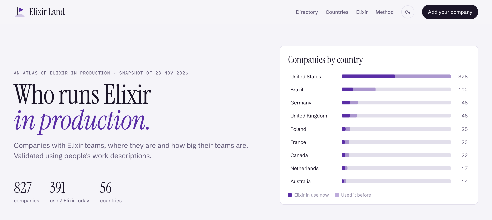
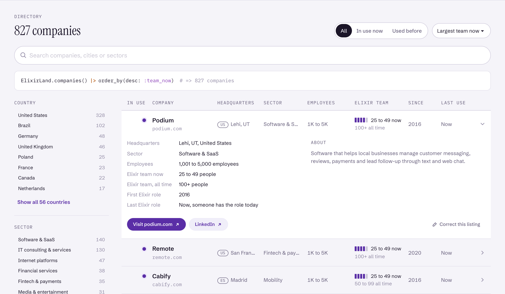

# Elixir Land

**Who runs Elixir in production.** A directory of companies with Elixir teams, by country, sector and team size. Open it at [elixir.land](https://elixir.land).

<a href="https://elixir.land">
  <picture>
    <source media="(prefers-color-scheme: dark)" srcset=".github/readme/hero-dark.png">
    
  </picture>
</a>

## Why

"Who uses Elixir in production?" Many people ask this question. A developer asks it before they learn the language. A team asks it before they choose Elixir for a new product. A person who wants an Elixir job asks it to find teams.

A good answer needs evidence. Elixir Land uses the job experiences that people write on LinkedIn. When people mention Elixir on a job at a company, that company has an Elixir team. For each company, the site shows:

- Where the company is and what it does.
- How many people use Elixir there now, and how many used it in the past.
- The first year and the last year in which someone had an Elixir job there.

The list also keeps the companies that used Elixir in the past. So you can see the first companies that used Elixir next to the companies that use it today.

The site never shows people, and team sizes are ranges. Many people do not write Elixir on LinkedIn, so the real numbers are larger. The [Method](https://elixir.land/#method) section on the site gives all the rules.

## What you can do

<picture>
  <source media="(prefers-color-scheme: dark)" srcset=".github/readme/directory-dark.png">
  
</picture>

- Search the companies by name, city, sector or website.
- Filter by country, sector, Elixir team size now, Elixir team size all time and company size.
- Sort by team size, by the first or the last year of Elixir use, by company size or by name.
- Share a view. The URL keeps the search, the filters and the sort, for example [elixir.land/?country=br&sort=since-asc](https://elixir.land/?country=br&sort=since-asc).
- Use the directory from an AI agent. The page gives read-only WebMCP tools: `search_companies`, `get_company` and `directory_stats`.

## Add your company

1. On LinkedIn, mention Elixir on your current job: add it as a skill on the job, or write it in the job title or the job description.
2. Ask one more person on your team to do the same. With 2 or more people, we always list the company.
3. [Send us the LinkedIn URL of the company](https://github.com/georgeguimaraes/elixir.land/issues/new?template=add-company.yml), for example linkedin.com/company/your-company.

The issue is public. Send the company page only. Do not send links to personal profiles.

## Local preview

```
elixir build/build.exs
elixir build/serve.exs
```

Then open http://127.0.0.1:8000/. Run the build again after each change to `build/`. The server uses the web server that comes with Erlang. To use a different port, give it as an argument: `elixir build/serve.exs 4000`.

The page has no external files except the fonts, so `open index.html` also works without a server.

## Build

```
elixir build/build.exs
```

The script does these steps:

1. It downloads the pinned Tailwind CLI to `build/bin` on the first run and checks its SHA-256. Git ignores `build/bin`.
2. It compiles `build/app.css` with Tailwind and daisyUI. The daisyUI plugin files are in `build/vendor`.
3. It puts the CSS and the JSON data in `build/data.json` into `build/atlas.src.html` and writes `index.html` at the repo root.

The build needs Elixir and curl. It does not need Node, npm or Python.

## Styles

- The page uses Tailwind utility classes in `build/atlas.src.html`, also in the class strings of the page script.
- The colors are CSS variables in `build/app.css`, with one block for light and one block for dark. Tailwind colors such as `bg-paper` and `text-muted` read these variables.
- The daisyUI theme also reads these variables, so `btn`, `input`, `select` and `card` follow the light and dark themes.
- `build/app.css` turns on only the daisyUI parts that the page uses, in the `include` list. Add a component to that list before you use it.
- To update Tailwind, change `@tailwind` and the two `@sha256` values in `build/build.exs`. Take the values from `sha256sums.txt` in the Tailwind release.
- To update daisyUI, replace `daisyui.mjs` and `daisyui-theme.mjs` in `build/vendor` with the files from a daisyUI release.

## Refresh the data

The data comes from a private dataset that is not in this repo. The export script lives with that dataset, so the raw data and the individual profiles never come into this repo.

1. Run the private export script. It writes `build/data.json`.
2. Run `elixir build/build.exs`.

`data.json` contains only company-level data. Team sizes are ranges. The site never lists people.

## Shared views

The URL holds the search, the filters, the status and the sort, so a visitor can share a view. For example: `https://elixir.land/?country=br&sort=since-asc`.

- The parameters are `q`, `country`, `sector`, `team_now`, `team_all_time`, `employees`, `status` and `sort`. They use the same names as the pipeline line on the page.
- A default value is not in the URL. The page ignores a value that it does not know.
- The page keeps other parameters, such as `utm_source`.

## Analytics

The page loads GoatCounter (`count.v4.js`) from `gc.zgo.at`, with an SRI hash. The dashboard is at https://georgeguimaraes.goatcounter.com.

- GoatCounter sets no cookies and does not count visits from localhost or `file://`.
- The page sends events for filters, searches, opened companies, clicks on links with a `data-track` attribute (as `click/<data-track>`, for example `click/website/Podium`) and agent tool calls. Event names hold company names and filter values, never visitor data.
- The "Show 40 more" button sends `more/<limit>`, with the row limit after the click: `more/80` after the first click, `more/120` after the second click. "Show all countries" and "Show all sectors" send `expand/countries` and `expand/sectors`.
- Footer links send `click/footer/<link>`, for example `click/footer/source`. The same links in the header and the Method section have their own names.
- To move to a new GoatCounter script version, change the `src` and the `integrity` hash in `build/atlas.src.html` together.

## License

- The code is under the MIT License. See `LICENSE`.
- The data and the text of the page are under CC BY 4.0. See `LICENSE-DATA.md`.
- The daisyUI files in `build/vendor` keep their own MIT License.

## Deploy

Every push to `main` runs `.github/workflows/deploy.yml`. The workflow runs `build/build.exs`, then publishes only `index.html` and `CNAME` to GitHub Pages.

The workflow has two jobs: `build` uploads the site as an artifact, and `deploy` publishes it. If only the `deploy` job fails, run the failed job again. Do not run all jobs again: the build job then uploads a second artifact with the same name, and the deploy fails.
